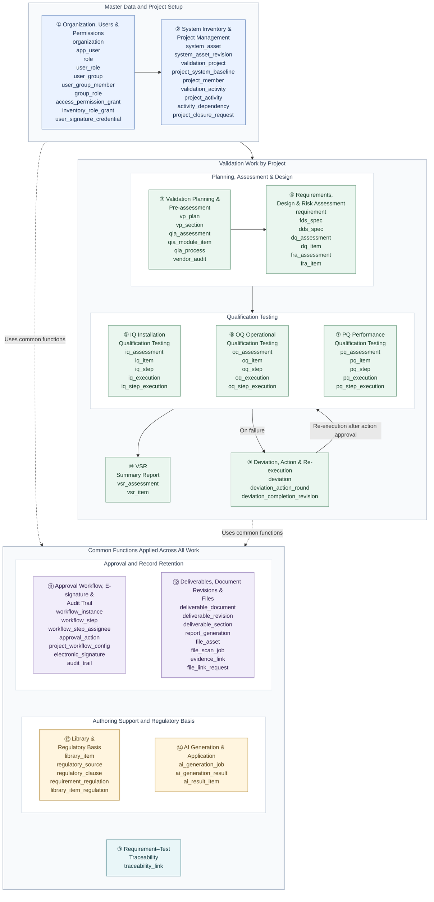

# Validation Management Platform Overall Data Structure

This diagram groups all **76 tables** into **14 business areas**. Each box shows the actual table names, and each table is placed only once.

The area numbers and names match areas 1–14 in the [ERD Specifications](./erd-specifications.md).

Solid lines show the composition of and business flow between areas, and dotted lines show the use of common functions. **The lines do not represent FKs between individual tables or a fixed execution order.** The actual execution scope and order follow the activities selected in the project and the dependency conditions applied. For detailed columns and relationships, see the [Data Dictionary](./data-dictionary.md).

## Overall Structure Diagram

## Key Connections

| Structure | Meaning of the Connection |
|---|---|
| `organization` → `system_asset` → `validation_project` | Validation projects are set up for the systems and equipment that belong to an organization. |
| `system_asset_revision` → `project_system_baseline` | Identifies the approved system revision adopted by the project. Test executions and document revisions are also linked to the baseline in effect at the time, preserving the past validation target. |
| `validation_project` → `project_member` | Manages the users participating in the project and their roles. |
| `validation_project` → `project_activity` → `validation_activity` | Selects the activities to be performed in the project. Dependency conditions use the criteria adopted from `activity_dependency` when the project was created. |
| `vp_plan` → `vp_section` / `qia_assessment` → `qia_module_item` → `qia_process` | The validation plan is managed as sections and body, and the quality impact assessment is managed as the common assessment, modules and processes. Vendor audits are recorded in `vendor_audit`. |
| `requirement` · `fds_spec` · `dds_spec` → `dq_item` | Assesses design suitability by linking specific revisions of requirements and design documents. |
| `requirement` → `fra_item` | Assesses the risk of each requirement and links the internal SOP basis through `regulatory_clause`. |
| IQ/OQ/PQ assessments → test items and steps → executions and per-step results | Separates test content from actual execution records. The test composition of each assessment revision is preserved, and test revisions whose content has not changed can be reused. |
| Failed execution → `deviation` → `deviation_action_round` → new execution | Manages actions and approvals per round while preserving the failure record. If a re-execution fails again, the next action round is added. Completion reports and closure reports are revised and approved in `deviation_completion_revision`. |
| Work results → `vsr_assessment` · `vsr_item` → project closure decision | Summarizes the results of the selected activities and preserves the basis as of the time of aggregation. Project closure requests and approvals are managed separately in `project_closure_request`. |
| Requirements, design, assessments and tests ↔ `traceability_link` | Manages trace relationships between specific revisions of work items. The RTM dashboard queries these links together with actual execution results. |
| `project_workflow_config` → `workflow_instance` → steps, assignees and action history | Separates approval route configuration from actual approval workflow cases. Steps and assignees are managed in `workflow_step` and `workflow_step_assignee`, and `approval_action` links the action history with electronic signatures. |
| `app_user` → `user_signature_credential` → `electronic_signature` | Each time a user signs, their identity is verified with a signature-only password separate from the login, and then a signature record is created. |
| `deliverable_document` → `deliverable_revision` → `deliverable_section` | Manages a deliverable's identifying information, revisions, and sections and body separately. Document revisions and the revisions and approvals of the underlying work are preserved separately. |
| User upload → `file_scan_job` → `file_asset` | Records the scan attempts and results for the quarantined original, and registers the file asset after the latest attempt confirms that no threats were detected and that the file is identical to the original. A retry is recorded as a new attempt that preserves the previous judgment. |
| User upload → `file_link_request` → evidence, design files, VA attachments | Right after upload, a link request is recorded for the business target to be linked, and the link is made automatically once the scan passes. If any request is pending, blocked or failed, submission and result registration for that target do not proceed. |
| Business records ↔ `evidence_link` ↔ `file_asset` | Links registered files as evidence for tests and documents. `report_generation` manages PDF generation jobs and the generated output files. |
| `regulatory_source` → `regulatory_clause` → regulatory basis for requirements and library items | Distinguishes editions of regulation documents from their clauses, and links the applicable basis through `requirement_regulation` and `library_item_regulation`. |
| `library_item` → requirements, risk assessments, test items | Imports reusable content and references the source library item. Imported items are managed independently and do not automatically reflect later library changes. |
| `ai_generation_job` → `ai_generation_result` → `ai_result_item` | Distinguishes AI generation requests, result sets and individual drafts. After user selection and application to the business work, the review and approval procedure of that work applies. |

## Notes for Readers

- **RTM is a query function, not an execution step.** It is not set up as a mandatory step after testing or as a separate aggregation activity of the VSR.
- **A deviation branches off when a test fails.** After the action is approved, the test can be re-executed, or the deviation can be closed without re-execution by recording a reason and an electronic signature.
- **FDS and DDS are each independent design documents.** In project activities, they are managed together as F&DS.
- **Upload completion is not the same as the file being usable.** A user upload can be used for attachments, downloads and AI input only after its scan job is `COMPLETED` with `NO_THREATS_FOUND` and the file asset has been registered. Trusted files generated internally on the server are distinguished by `file_origin`, and externally uploaded files used for generation must pass the scan first. The link target right after upload is recorded as a request in `file_link_request` and linked automatically after the scan passes.
- **Common functions are used across inventory and project work.** Not every common table references a project directly; for the business targets of approval workflows, signatures, audit trails and evidence, links that combine a type and an identifier are also used.
